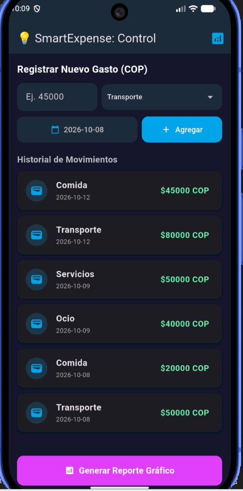
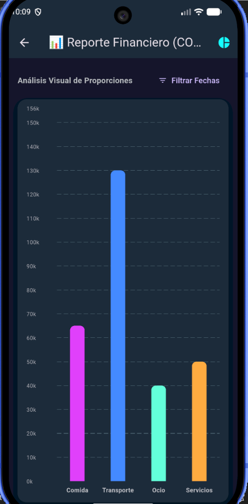
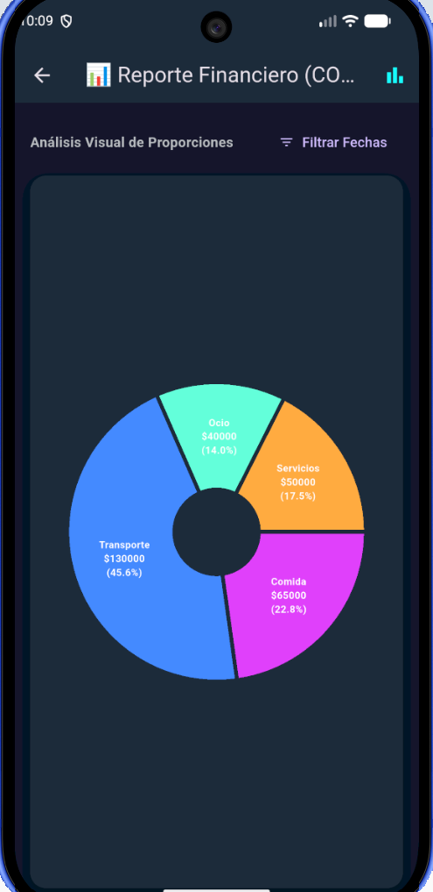

# 💡 SmartExpense - Gestor Financiero Inteligente en Flutter

Aplicación móvil desarrollada en **Flutter** orientada al control de gastos personales y a la **visualización dinámica de datos** utilizando la librería `fl_chart`. El proyecto permite registrar transacciones en Pesos Colombianos (COP), filtrarlas por rangos de fechas y generar análisis visuales interactivos en tiempo real (gráficos de barras y circulares).

---

## 🚀 Características Principales

* **Registro Dinámico de Gastos:** Permite ingresar montos monetarios, seleccionar categorías predefinidas (*Comida, Transporte, Ocio, Servicios*) y asignar una fecha específica a cada transacción.
* **Historial de Movimientos:** Visualización en tiempo real de todos los registros acumulados en memoria con formato de moneda local (COP).
* **Análisis Visual Interactivo (`fl_chart`):**
  * **Gráfico de Barras (`BarChart`):** Compara los totales acumulados por categoría con escalas adaptadas automáticamente en miles (`k`).
  * **Gráfico Circular / Rosca (`PieChart`):** Muestra la proporción porcentual exacta de cada categoría respecto al total del presupuesto en el rango seleccionado.
* **Filtrado por Rango de Fechas:** Selector temporal para acotar el reporte analítico a días o periodos específicos.
* **Arquitectura Modular:** Código limpio estructurado en pantallas (`screens`), componentes reutilizables (`widgets`) y modelos de datos.

---

## 📂 Estructura del Proyecto

```text
gastosview/
├── imagnes/                   # Capturas de pantalla de la aplicación
│   ├── home.png
│   ├── barras.png
│   └── pastel.png
├── lib/
│   ├── main.dart              # Configuración global y tema visual (Dark Theme)
│   └── screens/
│       ├── home_screen.dart   # Pantalla principal, formulario y lista de movimientos
│       └── chart_screen.dart  # Pantalla de análisis con barras, pastel y filtros
```

## 📱 Capturas de Pantalla

| Control de Gastos | Reporte de Barras | Reporte de Pastel |
| :---: | :---: | :---: |
|  |  |  |

## 🛠️ Tecnologías Utilizadas

* **[Flutter](https://flutter.dev/)** - Framework de desarrollo móvil multiplataforma.
* **[Dart](https://dart.dev/)** - Lenguaje de programación orientado a objetos.
* **[fl_chart](https://pub.dev/packages/fl_chart)** - Librería de gráficos altamente personalizables para Flutter.

## ⚙️ Instrucciones de Instalación y Ejecución

1. Clona este repositorio en tu computadora:
   ```bash
   git clone [https://github.com/TU_USUARIO/gastosview.git](https://github.com/TU_USUARIO/gastosview.git)
   ```
2. Entra a la carpeta del proyecto:
   ```bash
   cd gastosview
   ```
3. Instala las dependencias necesarias:
   ```bash
   flutter pub get
   ```
4. Ejecuta la aplicación en tu emulador o dispositivo físico:
   ```bash
   flutter run
   ```

## 👤 Autor

* **Andres Noguera**  
* Estudiante de Ingeniería de Sistemas – Universidad de Nariño